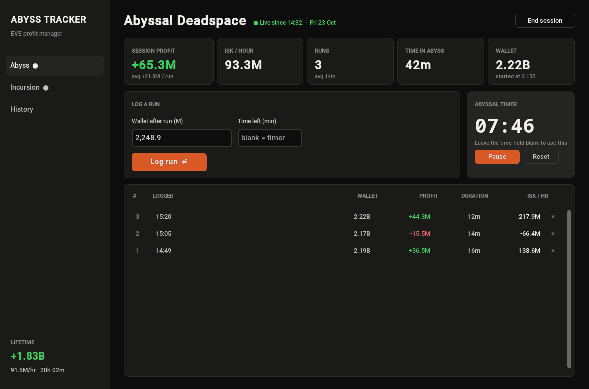
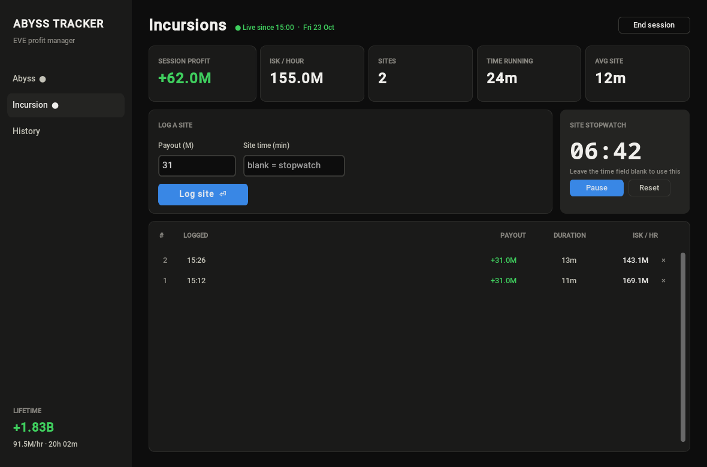
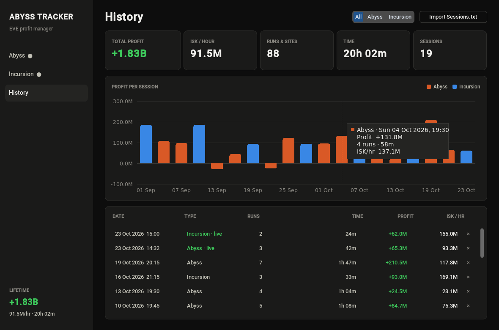

# Abyssal and Incursion Tracker

This program is designed to help users track their profits and time spent during Abyssal runs and Incursions in a massively multiplayer online role-playing game (MMORPG). It provides a user-friendly interface for inputting relevant data and automatically calculates profits based on initial and final ISK amounts and time spent in each activity.



## Table of Contents

- [Abyssal and Incursion Tracker](#abyssal-and-incursion-tracker)
  - [Table of Contents](#table-of-contents)
  - [Features](#features)
  - [Screenshots](#screenshots)
  - [Getting Started](#getting-started)
    - [Download](#download)
    - [Prerequisites](#prerequisites)
    - [Installation](#installation)
  - [Usage](#usage)
  - [Contributing](#contributing)
- [Todo:](#todo)
- [4/5/24 TextFile Functionality](#4524-textfile-functionality)
- [4/10/24](#4102024)
- [4/18/24](#4182024)
- [4/21/24](#42124)
- [10/23/26](#102326)

## Features

**Desktop app (`gui.py`):**
  - **Session page:** enter your wallet and pick the filament's weather and tier, then log each run with the new
    wallet total and the time left on the 20-minute timer. The large abyssal countdown can fill in the time for you
    (leave the field blank). The page takes the colours of the session's weather and shows its tactical hint.
  - **Incursion page:** set the payout per site (remembered between sessions) and log each site's time, typed or
    from the built-in stopwatch.
  - Each run shows as a tile with its profit, duration and **ISK/hour**, where you can fix (✎) or delete mistakes,
    with the session's profit, ISK/hour, time and wallet below.
  - **History page:** net profit, ISK/hour and winning sessions, a profit-per-session chart with hover details,
    ISK/hour for each weather (and the best one), and every past session with its weather and tier,
    filterable by Abyss/Incursion. Old `Sessions.txt` files can be imported.
  - Every run is saved immediately, so closing the app mid-session picks up where you left off.
  - Amounts are in millions of ISK; you can type `1,250`, `1.25b` or `800k`. Times accept `14.5` or `14:30`.

**Terminal tracker (`main.py`):** the original menu-driven tracker, now saving to the same database and showing ISK/hour.

Data is stored in SQLite at `%APPDATA%\AbyssTracker\tracker.db` on Windows
(`~/.local/share/AbyssTracker/tracker.db` elsewhere). Set `ABYSS_TRACKER_DB` to use a different file.

## Screenshots

Screenshots use sample data.

**Incursion page**: payout per site, site stopwatch and live session stats.



**History page**: lifetime totals, profit per session (hover a bar for details) and every past session.



## Getting Started

### Download

Ready-to-run builds are attached to each [release](https://github.com/Fazorath/AbyssTracker/releases); no Python needed.

- **Windows:** download `AbyssTracker-windows.exe` and run it. SmartScreen may warn because the file isn't signed:
  choose *More info → Run anyway*.
- **macOS (Apple Silicon):** download `AbyssTracker-macos.zip`, unzip it and move `AbyssTracker.app` to Applications.
  The app isn't notarized, so the first time right-click it and choose *Open*.

To run from source instead:

### Prerequisites

Python 3.10+ with Tkinter (included in the installers from [python.org](https://www.python.org/)).

### Installation

1. Clone the repository to your local machine:
   ```bash
   git clone https://github.com/Fazorath/AbyssTracker.git
   cd AbyssTracker
   ```
2. Install the required dependencies:
   ```bash
   pip install -r requirements.txt
   ```

## Usage

Desktop app:
```bash
cd EveProfitManager
python gui.py
```
Shortcuts: `Enter` logs a run/site, `Ctrl+1/2/3` switches between Abyss, Incursion and History.

Terminal version:
```bash
cd EveProfitManager
python main.py
```

Build the standalone app yourself (a `.exe` on Windows, an `.app` on macOS, in `dist/`):
```bash
pip install pyinstaller
cd EveProfitManager
pyinstaller AbyssTracker.spec
```
Pushing a `v*` tag (e.g. `git tag v1.0.0 && git push origin v1.0.0`) builds both on GitHub Actions and attaches
them to a release. The app icon is drawn by `make_icon.py`; files in `assets/` are bundled into the build.

Run the tests:
```bash
cd EveProfitManager
python -m unittest test_core
```

## Contributing
Contributions are welcome! If you find any bugs or have suggestions for improvements, please open an issue or submit a pull request.

License
This project is licensed under the MIT License - see the LICENSE file for details.
# Todo:
1. ~~Function to average out profits hourly in both the abyss and incursion functions~~
2. ~~error input for the Incursion Module~~
3. ~~add session details into file for Incursion Module~~
4. ~~Update incursion module to limit use of Globals and start using parameters~~
5. ~~Write to file function for abyss module instead of inside Run Function for aesthetics and proper code~~

# 4/5/24 TextFile Functionality
Adding to File branch created to work on the functionality to add 
end of session reports to a text file for more advanced storage

# 4/10/24
implemented adding the session details to a Txt file at the end to keep long-term
track of profits and time spent. + Getting the hang of using branches to work on specific info and then
pulling to the main.

# 4/18/24 
Got back into doing incursion with a cool group of people in WTM
I now have an abyssal tracker that prompts for profit which should always remain a stable 31m 
and then asks for time. I am going to focus now on making an average tracker at the end of the session that shows up to tell you how 
much you made per hour.

# 4/21/24
Incursion modules Try again prompt has been updated to use 0 and 1 as well as added
an incursion ran counter like in the abyss module to keep track.

# 10/23/26
Desktop UI built with CustomTkinter (`gui.py`): live session stats, a built-in abyssal timer, ISK/hour and a
history page with a chart. Tracking logic moved into `core.py` and now saves every run to SQLite instead of
appending summaries to Sessions.txt (which can still be imported). Fixed total profit carrying over between
abyss sessions, and the terminal version now works on Linux/macOS too.
